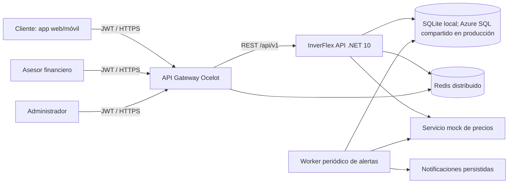

# Contexto C4 — InverFlex

**Límite de confianza:** el gateway valida firma, issuer, audience y expiración, exige `userId` para rutas API y aplica el límite distribuido de 200 solicitudes/minuto. La API vuelve a validar JWT y autorización; nunca confía únicamente en el gateway. El entorno local usa SQLite; para varias instancias se configura el proveedor SQL Server con Azure SQL compartido. Redis y la base de datos son compartidos por todas las réplicas.

**Componentes:** cliente de APIs, gateway Ocelot, API monolítica modular, base relacional, Redis, proveedor mock de precios y worker hospedado. El worker usa datos persistidos, no memoria local como fuente de verdad.
